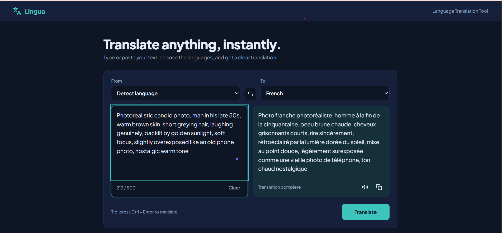

# Lingua: Language Translation Tool
   

A responsive web app that translates text between 20+ languages, built with plain HTML, CSS and JavaScript (no build step).

## Features
- Text input with source and target language selection (including auto-detect)
- Translation through a REST API (MyMemory by default, Google Translate API supported)
- Clear output panel with loading state and friendly error messages
- Copy to clipboard and text-to-speech (Web Speech API)
- Swap languages, character counter, Ctrl + Enter shortcut
- Remembers your last language choices
- Light and dark mode, keyboard accessible, mobile friendly

## Project structure
```
language-translation-tool/
├── index.html     Page structure
├── style.css      Styling and responsive layout
├── config.js      API provider and settings
├── languages.js   Supported languages list
├── script.js      App logic and API calls
└── README.md
```

## Run it
Open `index.html` in a browser, or serve the folder (for example with the VS Code "Live Server" extension).

## Choose the API
Edit `config.js`:
- `provider: "mymemory"` works immediately with no key (about 500 characters per request).
- `provider: "google"` uses the Google Cloud Translation API. Enable "Cloud Translation API" in Google Cloud Console, create an API key, and paste it into `googleApiKey`. Restrict the key to your domain, because front-end keys are publicly visible.

## Add a language
Add one line to `languages.js` with its API code, display name and speech locale.

## Notes
- Text-to-speech depends on voices installed on the device. Some languages (for example Yoruba, Igbo, Hausa) may have no voice in some browsers.
